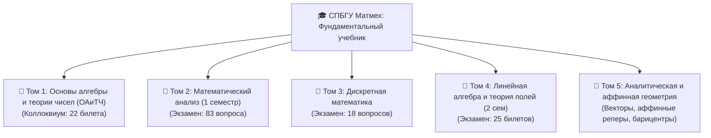

# 🎓 СПБГУ МАТМЕХ: СУПЕРУЧЕБНИК С ПОЛНОГО НУЛЯ
## Образовательная программа «Искусственный интеллект и наука о данных» (AI & Data Science)
### Потоки 24.Б71–Б83 / 25.Б7х–8х

---

> **«Математика — это не про запоминание формул, а про понимание того, почему иначе быть просто не могло».**

Добро пожаловать в фундаментальный суперучебник, созданный специально для студентов СПбГУ Матмеха. Если ты пришёл после школы или просто чувствуешь, что университетская математика обрушилась на тебя лавиной строгих определений, непонятных значков $\forall, \exists, \in, \mathbb{Z}/m\mathbb{Z}$ и доказательств, где лектор говорит «очевидно», — **этот учебник для тебя**.

Здесь **всё объясняется с абсолютного нуля**:
1. Сначала мы даём **живую интуицию («на пальцах»)**: зачем это нужно, какую проблему это решает в реальном мире и computer science.
2. Затем формулируем **железобетонное университетское определение** со всеми кванторами и условиями (по стандартам профессоров А. В. Королёва, Р. А. Шмидта, А. А. Семёнова, А. И. Кострикина, Г. М. Фихтенгольца).
3. Показываем **структурные схемы и иллюстрации**.
4. Приводим **пошаговые доказательства**, где не пропущен ни один логический переход.
5. Разбираем **примеры и контрпримеры**.
6. Указываем **ловушки на экзаменах**: на каких каверзных вопросах валят преподаватели и как на них отвечать на высший балл.

---

## 🗺️ Карта и структура учебника

Учебник разбит на 5 ключевых томов, в точности покрывающих все учебные дисциплины, коллоквиумы и экзамены 1 и 2 семестров:

### Связь с материалами и первоисточниками курса:
- **ОАиТЧ (Коллоквиум 1 семестр)**: билеты 1–22 (`Colloquium (2).pdf`, `main.pdf`, лекции проф. Королёва А. В., задачник Кострикина, конспект Семёнова и Шмидта).
- **Математический анализ (1 семестр)**: 83 экзаменационных вопроса (`Матан билеты (1 семестр).pdf`, конспекты Бегалиева К., классика Фихтенгольца и Кудрявцева).
- **Дискретная математика**: 18 билетов осени 2025 года (`Discrete_Fall_2025.pdf` — порядки, расписания, Dilworth, производящие функции, Монти Холл, Alias-метод).
- **Линейная алгебра и теория полей (2 семестр)**: 25 экзаменационных билетов (`photo_2026-09-04_15-13-23.jpg`, `АлгебраЭкзРукпБилеты1-25.pdf` — подпространства, СЛАУ, Грассман, операторы, квадратичные формы, закон Сильвестра, евклидовы пространства, поля Галуа $\mathbb{F}_{p^n}$, минимальные многочлены, теорема Гамильтона-Кэли).
- **Геометрия**: аффинные пространства, барицентрические координаты, симплексы (`SPBU_Vault/inbox/DATA/Геометрия`).

---

## 🔤 Математический алфавит и словарь символов

Прежде чем двигаться дальше, договоримся об обозначениях, чтобы формулы читались так же легко, как обычный текст:

| Символ | Как читается | Смысл на простом языке | Пример |
| :--- | :--- | :--- | :--- |
| $\forall$ | «Для любого», «для каждого» | Утверждение верно абсолютно для всех кандидатов | $\forall x \in \mathbb{R}: x^2 \ge 0$ |
| $\exists$ | «Существует», «найдётся» | Есть хотя бы один такой элемент | $\exists x \in \mathbb{R}: x + 5 = 0$ |
| $\exists!$ | «Существует и единственный» | Найдётся ровно один такой объект | $\exists! x \in \mathbb{R}: 2x = 6$ ($x=3$) |
| $\in$ / $\notin$ | «Принадлежит» / «не принадлежит» | Элемент входит / не входит во множество | $2 \in \mathbb{N}$, $-3 \notin \mathbb{N}$ |
| $\subset$ / $\subseteq$ | «Подмножество» | Все элементы первого множества лежат во втором | $\mathbb{N} \subset \mathbb{Z} \subset \mathbb{Q} \subset \mathbb{R} \subset \mathbb{C}$ |
| $\cup$ | «Объединение» (ИЛИ) | Входит хотя бы в одно из множеств | $A \cup B = \{x \mid x \in A \lor x \in B\}$ |
| $\cap$ | «Пересечение» (И) | Входит одновременно и в то, и в другое | $A \cap B = \{x \mid x \in A \land x \in B\}$ |
| $\setminus$ | «Разность» (без) | Элементы первого, которых нет во втором | $A \setminus B = \{x \mid x \in A \land x \notin B\}$ |
| $\Delta$ | «Симметрическая разность» | Элементы, принадлежащие ровно одному из двух | $A \Delta B = (A \setminus B) \cup (B \setminus A)$ |
| $\emptyset$ | «Пустое множество» | Множество, не содержащее ни одного элемента | $\{x \in \mathbb{R} \mid x^2 = -1\} = \emptyset$ (в $\mathbb{R}$) |
| $\implies$ | «Следовательно», «влечёт» | Если верно условие слева, то верно и справа | $x = 2 \implies x^2 = 4$ |
| $\iff$ | «Тогда и только тогда, когда» | Эквивалентно (верно в обе стороны) | $x + 1 = 3 \iff x = 2$ |
| $a \mid b$ | «$a$ делит $b$» | Число $b$ делится на $a$ нацело | $3 \mid 12$, но $5 \nmid 12$ |
| $b \ \vdots \ a$ | «$b$ делится на $a$» | То же самое, что $a \mid b$ | $12 \ \vdots \ 3$ |
| $a \equiv b \pmod m$ | «$a$ сравнимо с $b$ по модулю $m$» | Разность $a - b$ делится на $m$ нацело | $17 \equiv 5 \pmod{12}$ (на часах 17:00 это 5:00) |
| $\gcd(a, b)$ / $\operatorname{НОД}(a,b)$ | Наибольший общий делитель | Наибольшее целое число, делящее и $a$, и $b$ | $\operatorname{НОД}(24, 36) = 12$ |
| $\operatorname{lcm}(a, b)$ / $\operatorname{НОК}(a,b)$ | Наименьшее общее кратное | Наименьшее положительное общее кратное | $\operatorname{НОК}(4, 6) = 12$ |
| $a \perp b$ | «$a$ взаимно просто с $b$» | $\operatorname{НОД}(a, b) = 1$ | $8 \perp 15$ |
| $\mathbb{N}$ | Натуральные числа | $\{1, 2, 3, \dots\}$ (в СПбГУ обычно $0 \notin \mathbb{N}$) | $1, 2, 100$ |
| $\mathbb{Z}$ | Целые числа | $\{\dots, -2, -1, 0, 1, 2, \dots\}$ | $-5, 0, 7$ |
| $\mathbb{Q}$ | Рациональные числа | $\{p/q \mid p \in \mathbb{Z}, q \in \mathbb{N}, \gcd(p,q)=1\}$ | $-1/2, 0, 3/4$ |
| $\mathbb{R}$ | Вещественные числа | Непрерывная числовая прямая ($\mathbb{Q}$ + иррациональные) | $\sqrt{2}, \pi, e$ |
| $\mathbb{C}$ | Комплексные числа | $\{a + bi \mid a, b \in \mathbb{R}, i^2 = -1\}$ | $2 + 3i$ |

---

## 💡 Как готовиться к экзамену и коллоквиуму на Матмехе

1. **Билет состоит из трёх китов**:
   - **Определение** (нельзя потерять ни одного квантора! Если в определении предела забудешь $\forall \varepsilon > 0$, поставят неуд за билет).
   - **Формулировка теоремы** (всегда чётко формулируй условия: монотонность, ограниченность, непрерывность на *отрезке*, взаимная простота).
   - **Доказательство** (нужно уметь не воспроизводить наизусть, а понимать ключевую идею: «здесь строим цепочку равенств по индукции», «здесь применяем принцип Дирихле», «здесь используем метод от противного»).
2. **Дополнительные вопросы («допы»)**:
   - Профессор почти всегда спросит контрпример: *«А если убрать условие компактности/замкнутости отрезка, теорема верна?»*
   - В каждом разделе нашего учебника вынесен блок **⚠️ Ловушка на экзамене** со всеми излюбленными вопросами преподавателей.
